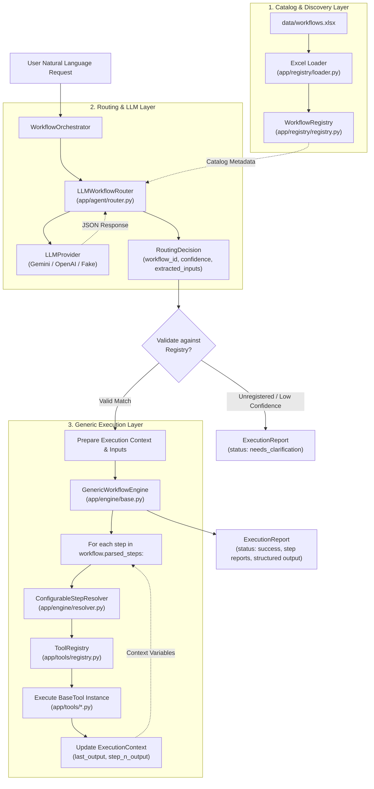

# AI Workflow Agent

A modular, Excel-driven AI workflow automation system built with **Python 3.12**, **Pydantic v2**, and **openpyxl**.

The system dynamically loads and validates business workflow definitions directly from an Excel workbook (`data/workflows.xlsx`), routes natural-language requests using an LLM-powered router (supporting **Google Gemini**, **OpenAI-compatible APIs**, or an offline **fallback**), resolves human-readable steps to registered domain tools, and executes them through a completely generic, reusable execution engine.

---

## Table of Contents

- [Key Features & Technology Stack](#key-features--technology-stack)
- [Architecture Overview](#architecture-overview)
- [Project Structure](#project-structure)
- [Official Workflow Catalog (WF001 – WF010)](#official-workflow-catalog-wf001--wf010)
- [Setup & Installation](#setup--installation)
- [LLM Provider Configuration](#llm-provider-configuration)
- [CLI Usage](#cli-usage)
  - [Live LLM Routing](#1-live-llm-routing)
  - [Deterministic Demonstration Mode (`--mock-route`)](#2-deterministic-demonstration-mode---mock-route)
  - [Structured JSON Output](#3-structured-json-output)
- [Routing, Confidence & Clarification Policy](#routing-confidence--clarification-policy)
- [Tool Execution, Data Safety & Simulation Transparency](#tool-execution-data-safety--simulation-transparency)
- [Demonstration Extension: WF011 Supplier Delivery Risk Assessment](#demonstration-extension-wf011-supplier-delivery-risk-assessment)
- [How to Extend the System with New Workflows](#how-to-extend-the-system-with-new-workflows)
- [Testing & Verification](#testing--verification)
- [Sample Datasets](#sample-datasets)
- [Limitations & Future Improvements](#limitations--future-improvements)

---

## Key Features & Technology Stack

- **Excel-Driven Dynamic Catalog**: Workflows are loaded at runtime from `data/workflows.xlsx`. Adding or updating workflows in the catalog requires no changes to core engine or router code.
- **LLM-Powered Semantic Router**: Translates natural-language requests into structured routing decisions with parameter extraction, zero-hallucination validation against the active registry, and confidence thresholding.
- **Generic Workflow Execution Engine**: `GenericWorkflowEngine` executes parsed workflow steps sequentially by resolving tools dynamically through dependency injection. It contains **zero workflow-specific branching** (`if workflow_id == ...`).
- **10 Official End-to-End Workflows**: Fully implemented domain tools for all workflows in the assessment workbook (WF001–WF010), handling boundary conditions, edge cases, and deterministic business rules.
- **Proven Extensibility (WF011)**: Includes a standalone demonstration extension (`WF011 — Supplier Delivery Risk Assessment`) proving that new workflows can be registered and executed through clean extension points without modifying core engine abstractions.
- **Zero Heavy SDK Dependencies**: HTTP communication with Google Gemini and OpenAI is implemented using Python's standard library `urllib` and `certifi`, avoiding bulky external SDKs.
- **Strict Data Safety & Offline Simulation**: All integrations operate against offline simulated sample data. No real external APIs, ERPs, or production databases are contacted, and inputs are never destructively overwritten.
- **Sanitized Error Handling**: Network and API exceptions are sanitized to ensure credentials, authorization headers, and raw provider payloads are never leaked into logs or application reasoning.

### Technology Stack

| Component | Technology | Purpose |
|---|---|---|
| Language | **Python 3.12+** | Core runtime |
| Data Modeling | **Pydantic v2** (`pydantic>=2.0.0`) | Validated data contracts, settings, and execution reports |
| Excel Ingestion | **openpyxl** (`openpyxl>=3.1.5`) | Workbook parsing and header validation |
| Environment Config | **python-dotenv** (`python-dotenv>=1.0.0`) | `.env` file discovery and loading |
| TLS / Certificates | **certifi** (`certifi>=2024.2.2`) | Mozilla root CA bundle for secure Gemini HTTPS requests |
| Test Framework | **pytest** (`pytest>=8.0.0`) | Automated test suite (154 passing tests) |

---

## Architecture Overview

The system decouples catalog ingestion, intent routing, step resolution, and tool execution into distinct, testable layers:



### Architectural Responsibilities

1. **`app/models/`**: Defines Pydantic models for workflow metadata (`WorkflowDefinition`), test requests (`EvaluationRequest`), step results (`StepExecutionResult`), and reports (`ExecutionReport`).
2. **`app/registry/`**: Loads `data/workflows.xlsx` via `openpyxl`, verifies sheets and columns, skips empty rows, validates data integrity, and populates the in-memory `WorkflowRegistry`.
3. **`app/agent/`**: Manages LLM communications (`provider.py`), formats system prompts dynamically (`prompts.py`), and routes natural-language requests into structured `RoutingDecision` objects (`router.py`).
4. **`app/engine/`**: Manages execution state (`context.py`), maps human-readable step names to tool names (`resolver.py`), and drives generic step-by-step execution (`base.py`).
5. **`app/tools/`**: Houses the `BaseTool` interface, `ToolRegistry`, and domain implementations across all business workflows.
6. **`app/orchestrator.py`**: Coordinates the entire pipeline (`User Request → Router → Registry → Engine → Step Resolver → Tools → Report`).
7. **`app/main.py`**: Command-line entrypoint with argument parsing, formatted table outputs, and raw JSON output options.

---

## Project Structure

```
ai-workflow-agent/
├── app/
│   ├── __init__.py
│   ├── main.py                  # CLI entrypoint and output formatters
│   ├── orchestrator.py          # End-to-end pipeline orchestrator
│   ├── agent/
│   │   ├── __init__.py
│   │   ├── prompts.py           # Dynamic system prompt & catalog formatting
│   │   ├── provider.py          # LLM providers (Gemini, OpenAI, FakeLLM)
│   │   └── router.py            # Natural-language workflow router
│   ├── api/
│   │   └── __init__.py          # Reserved API interface package
│   ├── engine/
│   │   ├── __init__.py
│   │   ├── base.py              # GenericWorkflowEngine (zero ID-specific logic)
│   │   ├── context.py           # ExecutionContext state store
│   │   └── resolver.py          # StepResolver and ConfigurableStepResolver
│   ├── models/
│   │   ├── __init__.py
│   │   ├── evaluation.py        # EvaluationRequest and test models
│   │   ├── execution.py         # StepExecutionResult & WorkflowExecutionResult
│   │   ├── report.py            # ExecutionReport and StepReport models
│   │   └── workflow.py          # WorkflowDefinition model and helpers
│   ├── registry/
│   │   ├── __init__.py
│   │   ├── exceptions.py        # Actionable catalog exception hierarchy
│   │   ├── loader.py            # openpyxl Excel ingestion and validator
│   │   └── registry.py          # Dynamic in-memory WorkflowRegistry
│   └── tools/
│       ├── __init__.py          # create_default_tool_registry()
│       ├── base.py              # BaseTool and ToolMetadata contracts
│       ├── campaign_brief.py    # WF007 domain tools
│       ├── content_generation.py# WF004 domain tools
│       ├── duplicate_detection.py# WF006 domain tools
│       ├── inventory.py         # WF001 domain tools
│       ├── order_status.py      # WF005 domain tools
│       ├── performance_report.py# WF010 domain tools
│       ├── pricing.py           # WF002 domain tools
│       ├── registry.py          # Reusable ToolRegistry
│       ├── seo_keywords.py      # WF008 domain tools
│       ├── supplier_risk.py     # WF011 demonstration extension domain tools
│       ├── task_assignment.py   # WF009 domain tools
│       └── vendor_processing.py # WF003 domain tools
├── data/
│   ├── workflows.xlsx           # Official assessment workbook (WF001–WF010)
│   ├── sample_employees.csv     # Simulated employee skills & workloads (WF009)
│   ├── sample_internal_prices.csv # Internal price list (WF002)
│   ├── sample_inventory.csv     # Inventory levels & reorder thresholds (WF001)
│   ├── sample_keywords.csv      # Search queries, volumes, CPC (WF008)
│   ├── sample_orders.csv        # Customer orders (WF005)
│   ├── sample_products_catalog.csv # Product catalog with duplicates (WF006)
│   ├── sample_shipments.csv     # Shipping carrier tracking records (WF005)
│   ├── sample_supplier_deliveries.csv # Simulated supplier deliveries (WF011)
│   ├── sample_vendor_catalog.csv# Unprocessed vendor feed with bad rows (WF003)
│   ├── sample_vendor_prices.csv # Vendor quotes (WF002)
│   └── sample_workflow_logs.csv # Execution telemetry logs (WF010)
├── tests/                       # 21 test modules (154 passing tests)
├── .env.example                 # Documented environment configuration template
├── .gitignore                   # Ignore patterns for secrets, venv, caches
├── pyproject.toml               # Project metadata, dependencies, and pytest config
└── README.md                    # Technical documentation
```

---

## Official Workflow Catalog (WF001 – WF010)

The ten official workflows defined in `data/workflows.xlsx` are implemented end-to-end with dedicated domain tools and deterministic business logic:

### 1. WF001 — Inventory Restock Check
- **Workbook Name**: Inventory Restock Check
- **Trigger**: *"Which products need restocking?"*
- **Steps**: Load inventory $\to$ compare current stock with minimum threshold $\to$ identify low-stock products $\to$ calculate reorder quantity $\to$ generate restock list.
- **Key Business Rules**:
  - A product requires restocking strictly when $\text{current\_stock} < \text{minimum\_stock}$.
  - Boundary: Items exactly at threshold ($\text{current\_stock} == \text{minimum\_stock}$) are marked adequately stocked ($\text{reorder\_quantity} = 0$).
  - Zero Stock: If $\text{current\_stock} == 0$, $\text{reorder\_quantity} = \text{minimum\_stock}$. Otherwise, $\text{reorder\_quantity} = \text{minimum\_stock} - \text{current\_stock}$.

### 2. WF002 — Product Price Validation
- **Workbook Name**: Product Price Validation
- **Trigger**: *"Find products where vendor price differs by more than 10%."*
- **Steps**: Load product prices $\to$ match products by SKU $\to$ compare internal and vendor prices $\to$ calculate percentage difference $\to$ flag exceptions.
- **Key Business Rules**:
  - Matches records using SKU.
  - Computes percentage difference: $\frac{|\text{internal\_price} - \text{vendor\_price}|}{\text{internal\_price}} \times 100\%$.
  - Boundary: Flags exceptions strictly when percentage difference is **strictly greater than 10.0%**. A difference of exactly $10.0\%$ is marked compliant.
  - Safely handles missing SKUs, invalid price strings, and unmatched vendor records.

### 3. WF003 — Vendor File Processing
- **Workbook Name**: Vendor File Processing
- **Trigger**: *"Process this vendor spreadsheet and show invalid rows."*
- **Steps**: Read file $\to$ detect columns $\to$ normalize column names $\to$ validate required fields $\to$ identify invalid rows $\to$ produce cleaned dataset.
- **Key Business Rules**:
  - Dynamically detects and normalizes synonym headers (e.g., `Item_SKU`, `Product_ID` $\to$ `sku`; `Unit_Price`, `Cost` $\to$ `price`).
  - Flags rows missing required fields (`sku`, `product_name`, `price`) or carrying malformed numbers.
  - **Non-destructive safety**: Produces a cleaned dataset and detailed error diagnostics; **never mutates or overwrites the input file**.

### 4. WF004 — Product Description Generator
- **Workbook Name**: Product Description Generator
- **Trigger**: *"Generate SEO content for this product."*
- **Steps**: Validate required attributes $\to$ create product description $\to$ generate short description $\to$ generate SEO title $\to$ generate meta description.
- **Key Business Rules**:
  - Requires `product_name`; raises an explicit validation error if missing.
  - **Zero Attribute Hallucination**: Generates copy strictly grounded in supplied attributes (`material`, `color`, `category`, `target_audience`). Unprovided optional attributes are omitted and explicitly marked as missing.
  - Badged with `is_simulated: True`.

### 5. WF005 — Customer Order Status
- **Workbook Name**: Customer Order Status
- **Trigger**: *"What is the status of order ORD-1001?"* / *"Where is my order?"*
- **Steps**: Validate identifier $\to$ search order data $\to$ retrieve order status $\to$ retrieve shipment information $\to$ summarize current status.
- **Key Business Rules**:
  - Validates order ID or customer email.
  - Joins matching order records with shipping carrier telemetry (carrier, tracking number, estimated delivery date).
  - Unknown Orders: If no order matches, prompts the user to provide an alternative identifier rather than failing silently.
  - Redacts sensitive PII and queries local simulated files without contacting live third-party carriers.

### 6. WF006 — Duplicate Product Detection
- **Workbook Name**: Duplicate Product Detection
- **Trigger**: *"Find duplicate products in catalog."*
- **Steps**: Load products $\to$ normalize names/SKUs $\to$ compare identifiers $\to$ compare product attributes $\to$ group likely duplicates $\to$ assign confidence.
- **Key Business Rules**:
  - Exact normalized SKU match $\to$ `DEFINITE` duplicate ($1.0$ confidence).
  - High attribute token overlap (Token Dice score $\ge 0.75$ with matching brand) $\to$ `LIKELY` duplicate.
  - Moderate attribute overlap ($0.65 \le \text{Dice} < 0.75$) $\to$ `POSSIBLE` duplicate (manual review recommended).
  - Completely distinct products are not grouped together.

### 7. WF007 — Marketing Campaign Brief
- **Workbook Name**: Marketing Campaign Brief
- **Trigger**: *"Generate marketing campaign brief."*
- **Steps**: Validate inputs $\to$ identify campaign objective $\to$ summarize products $\to$ create messaging $\to$ create channel recommendations $\to$ create campaign checklist.
- **Key Business Rules**:
  - Requires `campaign_goal` and `dates`; raises an error if either is omitted.
  - **No Fabricated Claims**: Never invents unverified discounts or promotional claims unless explicitly provided by the user.
  - Produces structured deliverables: core objective, audience messaging, recommended channels, and launch checklist.

### 8. WF008 — SEO Keyword Classification
- **Workbook Name**: SEO Keyword Classification
- **Trigger**: *"Classify these keywords and map them to pages."*
- **Steps**: Read keywords $\to$ remove duplicates $\to$ classify search intent $\to$ map keywords to categories $\to$ identify high-priority keywords $\to$ export results.
- **Key Business Rules**:
  - Deduplicates keywords case-insensitively while preserving maximum search volume.
  - Classifies intent into four deterministic categories: `informational`, `commercial`, `transactional`, or `navigational`.
  - Maps keywords to product categories and target URL slugs.
  - Assigns `HIGH`, `MEDIUM`, or `LOW` priority based on conversion intent, volume, and CPC.

### 9. WF009 — Employee Task Assignment
- **Workbook Name**: Employee Task Assignment
- **Trigger**: *"Assign this urgent task to the best available developer."*
- **Steps**: Understand task requirements $\to$ compare employee skills $\to$ check current workload $\to$ rank candidates $\to$ select employee $\to$ generate assignment summary.
- **Key Business Rules**:
  - Extracts required skills, priority, and deadline from task descriptions.
  - Evaluates matching skills against candidate employee profiles.
  - Evaluates bandwidth based on logged hours and weekly maximum capacity.
  - Computes composite suitability score: $0.5 \times \text{skill\_match} + 0.5 \times \text{capacity\_ratio}$.
  - **Escalation Trigger**: Triggers an explicit escalation alert (`escalation_required: True`, `assigned_employee: None`) if no employee has matching skills or all qualified candidates are at 100% capacity.

### 10. WF010 — Workflow Performance Report
- **Workbook Name**: Workflow Performance Report
- **Trigger**: *"Which workflows are failing most often?"*
- **Steps**: Load execution logs $\to$ calculate success/failure rate $\to$ calculate average execution time $\to$ identify frequent errors $\to$ identify slow steps $\to$ generate recommendations.
- **Key Business Rules**:
  - Analyzes execution logs to compute total runs, success rates, failure rates, and average runtimes.
  - Strictly flags workflows with failure rate exceeding $10.0\%$ (e.g., WF003 at $25.0\%$).
  - Flags workflows with average latency exceeding the configured threshold (default $5.0\text{s}$, e.g., WF003 at $6.15\text{s}$).
  - Groups and ranks top recurring error messages and isolates bottleneck steps exceeding $4.0\text{s}$.
  - Produces actionable, prioritized improvement recommendations.

---

## Setup & Installation

### Prerequisites
- **Python 3.12+**
- `git`

### 1. Clone the Repository
```bash
git clone https://github.com/harshrew-bit/ai-workflow-agent.git
cd ai-workflow-agent
```

### 2. Create and Activate a Virtual Environment

**On macOS / Linux:**
```bash
python3 -m venv .venv
source .venv/bin/activate
```

**On Windows:**
```powershell
python -m venv .venv
.venv\Scripts\activate
```

### 3. Install the Project in Editable Mode
Install the package in editable mode with development dependencies using the project's `pyproject.toml` configuration:

```bash
python -m pip install -e ".[dev]"
```

This installs:
- `openpyxl>=3.1.5` (Excel workbook parsing)
- `pydantic>=2.0.0` (data modeling & validation)
- `python-dotenv>=1.0.0` (automatic `.env` loading)
- `certifi>=2024.2.2` (secure SSL certificate store for HTTPS)
- `pytest>=8.0.0` (automated testing suite)

---

## LLM Provider Configuration

The router supports **Google Gemini**, **OpenAI-compatible APIs**, and a hermetic **Fake / Fallback provider**. Configuration is loaded from environment variables via `python-dotenv`.

Copy the example template to create your `.env` file:
```bash
cp .env.example .env
```

### Option A: Google Gemini (Recommended)

Set the following in `.env` or export in your shell:
```env
LLM_PROVIDER=gemini
GEMINI_API_KEY=your_actual_gemini_api_key_here
GEMINI_MODEL=gemini-1.5-flash
```

*Implementation detail*: `GeminiProvider` sends the API key in the `x-goog-api-key` HTTP header rather than query parameters, preventing credentials from appearing in URL logs or tracebacks. It uses `certifi.where()` to establish secure SSL connections without requiring the external Google GenAI SDK.

### Option B: OpenAI or OpenAI-Compatible Endpoints

```env
LLM_PROVIDER=openai
OPENAI_API_KEY=your_actual_openai_api_key_here
OPENAI_MODEL=gpt-4o-mini
# Optional custom base URL (defaults to https://api.openai.com/v1):
# OPENAI_BASE_URL=https://api.openai.com/v1
```

### Option C: Offline Testing & Fallback (Default)

When neither `GEMINI_API_KEY` nor `OPENAI_API_KEY` is configured in the environment, the system automatically defaults to a safe **unconfigured fallback provider**:
- It **never** crashes or attempts unauthorized network requests.
- It **never** pretends an LLM made a decision.
- It returns `workflow_id = None`, `confidence = 0.0`, and `requires_clarification = True`, explicitly reporting that automated live routing is inactive.

---

## CLI Usage

The command-line interface is accessed via `python -m app.main`. View all options with:
```bash
python -m app.main --help
```

### 1. Live LLM Routing

When configured with an active Gemini or OpenAI API key, queries are routed through the live model:

```bash
# Example with Gemini configured in .env:
python -m app.main "Which products need restocking?"

# Example with explicit arguments:
python -m app.main --order-id "ORD-1001" "Where is my order?"
```

If the request is ambiguous or unrecognized, the router returns a clarification request:
```bash
python -m app.main "Can you bake me a chocolate cake?"
# Result: Status: NEEDS_CLARIFICATION — No tools executed.
```

### 2. Deterministic Demonstration Mode (`--mock-route`)

To evaluate workflow tool execution, boundary conditions, and reports deterministically without calling live external LLM APIs, pass `--mock-route <WORKFLOW_ID>`.

> [!NOTE]
> `--mock-route WFxxx` forces deterministic workflow selection for testing and demonstration. It does **not** evaluate live LLM semantic routing.

```bash
# WF001: Inventory Restock Check
python -m app.main --mock-route WF001 "Which products need restocking?"

# WF002: Product Price Validation
python -m app.main --mock-route WF002 "Find products where vendor price differs by more than 10%."

# WF003: Vendor File Processing
python -m app.main --mock-route WF003 "Process this vendor spreadsheet and show invalid rows."

# WF004: Product Description Generator
python -m app.main --mock-route WF004 "Generate SEO content for this product."
python -m app.main --mock-route WF004 --product-name "Ergonomic Desk Chair" --color "Black" --material "Mesh" "Generate copy"

# WF005: Customer Order Status (known order)
python -m app.main --mock-route WF005 --order-id "ORD-1001" "What is the status of order ORD-1001?"

# WF005: Customer Order Status (unknown order -> prompts for another identifier)
python -m app.main --mock-route WF005 --order-id "ORD-9999" "Check order status"

# WF006: Duplicate Product Detection
python -m app.main --mock-route WF006 "Find duplicate products in catalog"

# WF007: Marketing Campaign Brief
python -m app.main --mock-route WF007 --campaign-goal "Launch Eco Line" --dates "Nov 1 - Nov 30" "Create campaign brief"

# WF008: SEO Keyword Classification
python -m app.main --mock-route WF008 "Classify these keywords and map them to pages."

# WF009: Employee Task Assignment
python -m app.main --mock-route WF009 "Assign this urgent task to the best available developer."
python -m app.main --mock-route WF009 --task-desc "Develop GraphQL service" --skills "graphql, python" --task-priority "Urgent" "Assign task"

# WF010: Workflow Performance Report
python -m app.main --mock-route WF010 "Which workflows are failing most often?"

# WF011: Supplier Delivery Risk Assessment (Demonstration Extension)
python -m app.main --mock-route WF011 "Assess supplier delivery risk"
```

### 3. Structured JSON Output

Append `--json` to any CLI command to output the full machine-readable `ExecutionReport`:

```bash
python -m app.main --mock-route WF001 --json "Which products need restocking?"
```

---

## Routing, Confidence & Clarification Policy

`LLMWorkflowRouter` applies the following validation policy to all decisions:

1. **Confidence Semantics**:
   The `confidence` score in `RoutingDecision` represents the **model-reported routing certainty score** (0.0 to 1.0) returned by the LLM, **not a mathematically calibrated probability**. The system compares this score directly against `confidence_threshold` (default `0.70`).
2. **Registry Verification (Zero Hallucination Tolerance)**:
   The selected `workflow_id` must match a workflow currently registered in the catalog. If the model returns an unregistered or invented ID (e.g., `WF999`), the decision is rejected, `workflow_id` is set to `None`, `confidence` is reset to `0.0`, and `requires_clarification` is set to `True`.
3. **Threshold Enforcement**:
   Matches scoring below `confidence_threshold` are flagged with `requires_clarification = True`, preventing execution on weak guesses.
4. **Ambiguous or Unrelated Requests**:
   If the user query does not match any registered workflow trigger or lacks critical parameters, the router returns `workflow_id = None` and `requires_clarification = True`.
5. **Sanitized Provider Error Handling**:
   Network errors, timeouts, or HTTP errors are sanitized to prevent secret leakage. Raw HTTP response bodies, request URLs containing credentials, and authorization headers are never exposed in exceptions or user-facing reasoning.
6. **Explicit Unconfigured Fallback**:
   When no live LLM credentials are present, the system defaults to a safe fallback provider that returns `workflow_id = None`, `requires_clarification = True`, and explicitly states that automated live LLM routing is inactive. It never silently pretends a live model completed the routing.

---

## Tool Execution, Data Safety & Simulation Transparency

The execution engine and tool registry enforce strict operational safety:

- **Genuine Tool Invocation**: `GenericWorkflowEngine` never marks a step `COMPLETED` without invoking the actual registered `BaseTool.execute()` method.
- **Cascading Context**: Results from earlier steps are recorded in `ExecutionContext` (`last_output`, `step_1_output`, etc.) and automatically mapped to downstream step inputs.
- **Non-Destructive File Ingestion**: Ingestion workflows (such as WF003 vendor processing) validate data in memory and write cleaned views; they **never overwrite or mutate input files**.
- **Simulated Offline Operations**:
  - Sample inventory, order, shipping, employee, and supplier records are purely local synthetic data.
  - No real-world shipping carriers (FedEx, UPS), ERPs (SAP), or HR tools (Jira, Workday) are called.
  - Outputs and reports from simulated domain workflows carry explicit `is_simulated: True` metadata.

---

## Demonstration Extension: WF011 Supplier Delivery Risk Assessment

To prove that the architecture supports additional workflows without modifying core engine abstractions, the repository includes a demonstration extension: **WF011 — Supplier Delivery Risk Assessment**.

> [!IMPORTANT]
> **WF011 is a demonstration extension**, created in Python to prove architectural extensibility. It is **not** part of the official assessment workbook (`data/workflows.xlsx`), which remains strictly preserved with its original SHA-256 checksum.

### Business Logic & Deterministic Thresholds

1. **Delay Calculation**: For each delivery, computes $\text{delay\_days} = \text{actual\_date} - \text{promised\_date}$. Shipments with $\text{delay\_days} > 0$ are flagged as late.
2. **Per-Supplier Metrics**: Calculates total shipments, late shipments, late delivery rate ($\frac{\text{late}}{\text{total}}$), and average delay in days for late deliveries.
3. **Deterministic Risk Score (0 to 100)**:
   $$\text{risk\_score} = \min\left(100.0, \, (\text{late\_delivery\_rate} \times 60.0) + \min(\text{average\_delay\_days} \times 8.0, \, 40.0)\right)$$
4. **Risk Categorization**:
   - **HIGH RISK**: $\text{risk\_score} \ge 50.0$ OR $\text{late\_delivery\_rate} \ge 0.35$ OR $\text{average\_delay\_days} \ge 7.0$. Action: Formal vendor review, source backup suppliers.
   - **MEDIUM RISK**: $\text{risk\_score} \ge 25.0$ OR $\text{late\_delivery\_rate} \ge 0.15$ OR $\text{average\_delay\_days} \ge 3.0$. Action: Monitor lead times weekly.
   - **LOW RISK**: Otherwise. Action: Maintain preferred status.

### Verification Command
```bash
python -m app.main --mock-route WF011 "Assess supplier delivery risk"
```

---

## How to Extend the System with New Workflows

The system demonstrates zero-engine-modification extensibility. Adding an additional workflow requires **no modifications to core execution engine code**:

### What Remains Unchanged
- **`app/engine/base.py` (`GenericWorkflowEngine`)**: **0 lines changed**. It executes any workflow purely from step names and registered tool bindings.
- **`app/orchestrator.py` (`WorkflowOrchestrator`)**: **0 lines changed**.
- **`app/agent/router.py` (`LLMWorkflowRouter`)**: **0 lines changed**.
- **`data/workflows.xlsx`**: Preserved unchanged.

### What Must Be Created
Adding a new workflow involves two clear steps:

1. **Define the Workflow Metadata (Catalog Configuration)**:
   Create a `WorkflowDefinition` programmatically or add a row to an Excel catalog:
   ```python
   from app.models.workflow import WorkflowDefinition

   wf = WorkflowDefinition(
       Workflow_ID="WF012",
       Workflow_Name="Invoice Discrepancy Reconciliation",
       Trigger="Reconcile vendor invoices against purchase orders",
       Inputs="Invoice CSV, PO database",
       Steps="Load invoice -> Match PO -> Compare amounts -> Flag discrepancy",
       Decision_Logic="Flag discrepancy if invoice amount exceeds PO by > 5%",
       Tools_Required="invoice_loader, po_matcher, amount_comparator, discrepancy_flagger",
       Expected_Output="Reconciliation report with flagged variances",
   )
   ```

2. **Implement and Register the Step Tools (Plugin Registration)**:
   Create domain tools inheriting from `BaseTool`:
   ```python
   from app.tools.base import BaseTool, ToolMetadata

   class InvoiceLoaderTool(BaseTool):
       @property
       def metadata(self) -> ToolMetadata:
           return ToolMetadata(name="invoice_loader", description="Loads invoice records")

       def execute(self, **kwargs):
           return {"invoices_loaded": 10}
   ```
   Register the tools, step bindings, and workflow definition:
   ```python
   # Register tool
   tool_registry.register(InvoiceLoaderTool())

   # Bind human-readable step to tool
   step_resolver.bind(
       workflow_id="WF012",
       step_name="Load invoice",
       tool_name="invoice_loader",
   )

   # Register workflow in catalog
   workflow_registry.register(wf)
   ```

---

## Testing & Verification

The test suite contains **154 automated tests** with 100% pass rate.

### Run All Tests
```bash
pytest -v
```

### Run Quick Summary
```bash
pytest -q
```

### Run Tests by Feature Area
```bash
# Core models, loader, registry, interfaces
pytest tests/test_models.py tests/test_loader.py tests/test_registry.py tests/test_engine_interfaces.py

# Router and execution engine
pytest tests/test_router.py tests/test_execution.py tests/test_orchestrator.py

# Official workflows (WF001 – WF010)
pytest tests/test_wf001_inventory.py
pytest tests/test_wf002_pricing.py
pytest tests/test_wf003_vendor_processing.py
pytest tests/test_wf004_content_generation.py
pytest tests/test_wf005_order_status.py
pytest tests/test_wf006_duplicate_detection.py
pytest tests/test_wf007_campaign_brief.py
pytest tests/test_wf008_seo_keywords.py
pytest tests/test_wf009_task_assignment.py
pytest tests/test_wf010_performance_report.py

# End-to-end multi-workflow integration suites
pytest tests/test_orchestrator_wf002_wf004.py
pytest tests/test_orchestrator_wf005_wf007.py
pytest tests/test_orchestrator_wf008_wf010.py

# Extensibility demonstration (WF011)
pytest tests/test_wf011_extensibility.py
```

### Check Code Formatting and Whitespace
```bash
git diff --check
```

---

## Sample Datasets

All sample datasets reside in `data/` and represent realistic, synthetic test fixtures:

| File | Associated Workflow | Purpose & Key Characteristics |
|---|---|---|
| `workflows.xlsx` | All (WF001–WF010) | Official assessment workbook defining the 10 core business workflows. |
| `sample_inventory.csv` | WF001 | Products with varied stock counts, reorder thresholds, zero stock, and exact threshold items. |
| `sample_internal_prices.csv` | WF002 | Internal product price list with SKUs and baseline prices. |
| `sample_vendor_prices.csv` | WF002 | Vendor quotes with compliant prices, >10% discrepancies, and unmatched SKUs. |
| `sample_vendor_catalog.csv` | WF003 | Raw vendor catalog containing header variations (`Item_SKU`, `Unit_Price`) and malformed rows. |
| `sample_orders.csv` | WF005 | Customer orders with order IDs, order dates, line items, and totals. |
| `sample_shipments.csv` | WF005 | Shipping tracking numbers, carriers (FedEx, UPS), and delivery statuses linked to orders. |
| `sample_products_catalog.csv` | WF006 | Product catalog with exact SKU duplicates, near-duplicate models (Token Dice), and distinct items. |
| `sample_keywords.csv` | WF008 | SEO search queries with search volumes, CPC bids, competition scores, and intentional duplicates. |
| `sample_employees.csv` | WF009 | Employee profiles with technical skills, hourly availability, and current workloads. |
| `sample_workflow_logs.csv` | WF010 | 39 execution runs with realistic failure rates (>10% on WF003 & WF005) and latency bottlenecks (>5s on WF003). |
| `sample_supplier_deliveries.csv` | WF011 | 19 simulated deliveries across 4 suppliers with varying delivery punctuality and delays. |

---

## Limitations & Future Improvements

### Current Limitations
1. **Synchronous Step Execution**: `GenericWorkflowEngine` executes steps sequentially. Workflows with independent parallel steps execute linearly.
2. **Local In-Memory State**: State is preserved within an `ExecutionContext` during a single run. Intermediate step states are not persisted to an external database (e.g., PostgreSQL or Redis).
3. **Read-Only Workbook Storage**: In the current architecture, official workflow metadata is ingested from an Excel workbook at startup rather than queried from a dynamic relational database.
4. **Offline Domain Tools**: All business tools operate on local files and simulated data. Connecting to live production APIs (FedEx, Salesforce, Workday, SAP) would require enterprise authentication and rate-limiting infrastructure.

### Future Improvements
1. **Asynchronous & Parallel Execution**: Upgrade `GenericWorkflowEngine` to evaluate step dependency graphs (DAGs) and execute independent steps concurrently with `asyncio`.
2. **REST API Service Layer**: Expose the orchestrator through a FastAPI application in `app/api/` with streaming server-sent events (SSE) for step-by-step UI progress.
3. **Database-Backed Catalog**: Support database-backed workflow definitions (PostgreSQL / SQLite) alongside Excel workbooks for real-time CRUD management.
4. **Interactive Human-in-the-Loop Approval**: Allow tools (e.g., automated purchase orders or price adjustments) to pause execution and wait for human supervisor approval before proceeding.
