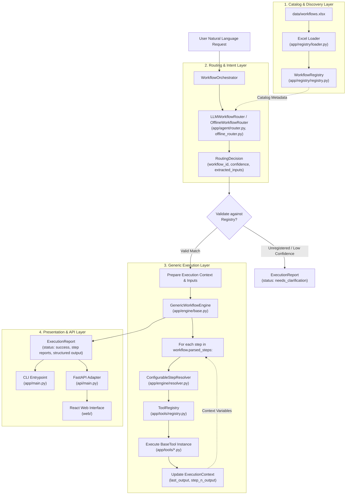

# AI Workflow Agent

A modular, Excel-driven AI workflow automation system built with **Python 3.12**, **Pydantic v2**, and **openpyxl**, paired with a **FastAPI backend adapter** and a modern **React web interface**.

The system dynamically loads and validates business workflow definitions directly from an Excel workbook (`data/workflows.xlsx`), routes natural-language requests using an LLM-powered router (supporting **Google Gemini**, **OpenAI-compatible APIs**, or a deterministic offline **fallback**), resolves human-readable steps to registered domain tools, and executes them through a generic, reusable execution engine.

---

## Table of Contents

- [Quick Demo (No API Key Needed)](#quick-demo-no-api-key-needed)
- [Live LLM Routing: Status](#live-llm-routing-status)
- [Key Features & Technology Stack](#key-features--technology-stack)
- [Architecture Overview](#architecture-overview)
- [Project Structure](#project-structure)
- [Official Workflow Catalog (WF001 - WF010)](#official-workflow-catalog-wf001---wf010)
- [Setup & Installation](#setup--installation)
- [Web UI & FastAPI Adapter](#web-ui--fastapi-adapter)
- [LLM Provider Configuration](#llm-provider-configuration)
- [CLI Usage](#cli-usage)
  - [Offline Natural Language Routing](#1-offline-natural-language-routing-default)
  - [Live LLM Routing](#2-live-llm-routing)
  - [Deterministic Demonstration Mode (`--mock-route`)](#3-deterministic-demonstration-mode---mock-route)
  - [Structured JSON Output](#4-structured-json-output)
- [Routing, Confidence & Clarification Policy](#routing-confidence--clarification-policy)
- [Deterministic Offline Router & Scoring](#deterministic-offline-router--scoring)
- [Tool Execution, Data Safety & Simulation Transparency](#tool-execution-data-safety--simulation-transparency)
- [Exit Codes & Operational Behavior](#exit-codes--operational-behavior)
- [Demonstration Extension: WF011 Supplier Delivery Risk Assessment](#demonstration-extension-wf011-supplier-delivery-risk-assessment)
- [How to Extend the System with New Workflows](#how-to-extend-the-system-with-new-workflows)
- [Testing & Verification](#testing--verification)
- [Sample Datasets](#sample-datasets)
- [Limitations & Future Improvements](#limitations--future-improvements)

---

## Quick Demo (No API Key Needed)

The agent runs fully offline out of the box using deterministic token matching against the official workbook definitions. Try these three commands in your terminal:

### 1. Inventory Restock Check (WF001)
```bash
python -m app.main "Check today's inventory and identify products that need restocking."
```
- **Expected Outcome**: Status `SUCCESS`, Selected Workflow `WF001 (Inventory Restock Check)`, `Routing Mode: OFFLINE`.
- **Result**: Identifies 4 low-stock items (`PRD-001`, `PRD-003`, `PRD-005`, `PRD-007`) requiring 61 total reorder units, exits with code `0`.

### 2. Customer Order Status (WF005)
```bash
python -m app.main "Where is order ORD-1001?"
```
- **Expected Outcome**: Status `SUCCESS`, Selected Workflow `WF005 (Customer Order Status)`, `Routing Mode: OFFLINE`.
- **Result**: Extracts order ID `ORD-1001`, returns status `SHIPPED` with carrier tracking details (`FastShip Express`, `TRK-987654321`), exits with code `0`.

### 3. Off-Topic Query Rejection
```bash
python -m app.main "What is the weather in Paris?"
```
- **Expected Outcome**: Status `NEEDS_CLARIFICATION`, Selected Workflow `None`, `Routing Mode: OFFLINE`.
- **Result**: Cleanly flags that the request cannot be matched to any registered workflow, executes zero domain tools, exits with code `4`.

---

## Live LLM Routing: Status

- **Status**: **VERIFIED — WF002 end-to-end**.
- **Provider**: Google Gemini API using `gemini-2.5-flash-lite`, configured through environment variables.
- **Verification result**: Live LLM routing selected `WF002 (Product Price Validation)` and the complete workflow executed successfully using the sample internal and vendor price CSVs.
- **Observed output**: 7 products matched and compared; 3 exceptions exceeded the strict 10% price-difference threshold. Unmatched SKUs were also reported.
- **Verification scope**: Live API execution has been verified for WF002. The other official workflows have been exercised using local sample data and offline tests; this does not imply that all workflows have been individually verified with a live LLM.
- **Offline behavior**: The deterministic offline router remains available when live LLM configuration is unavailable. See [`examples/live/README.md`](examples/live/README.md) for setup instructions and live-routing verification commands.

---

## Key Features & Technology Stack

- **Excel-Driven Dynamic Catalog**: Workflows are loaded at runtime from `data/workflows.xlsx`. Adding or updating workflows in the catalog requires no changes to core engine or router code.
- **LLM-Powered Semantic Router**: Translates natural-language requests into structured routing decisions with parameter extraction, zero-hallucination validation against the active registry, and confidence thresholding.
- **Deterministic Offline Fallback**: Features an explainable token-scoring router with domain-aware negative discrimination (e.g. separating pricing audits from supplier delivery risk) and multi-intent detection.
- **Generic Workflow Execution Engine**: `GenericWorkflowEngine` executes parsed workflow steps sequentially by resolving tools dynamically through dependency injection. It contains **zero workflow-specific branching** (`if workflow_id == ...`).
- **10 Official End-to-End Workflows**: Fully implemented domain tools for all workflows in the assessment workbook (WF001–WF010), handling boundary conditions, edge cases, and deterministic business rules.
- **Proven Extensibility (WF011)**: Includes a standalone demonstration extension (`WF011 — Supplier Delivery Risk Assessment`) proving that new workflows can be registered and executed through clean extension points without modifying core engine abstractions.
- **FastAPI Backend & React Web Interface**: Includes a lightweight FastAPI adapter (`api/main.py`) exposing the orchestrator and a polished, request-driven React 18 web UI (`web/`) with live execution timeline, step outputs, and routing diagnostics.
- **Zero Heavy SDK Dependencies**: HTTP communication with Google Gemini and OpenAI is implemented using Python's standard library `urllib` and `certifi`, avoiding bulky external SDKs.
- **Strict Data Safety & Offline Simulation**: All integrations operate against offline simulated sample data. No real external APIs, ERPs, or production databases are contacted, and inputs are never destructively overwritten.
- **Sanitized Error Handling**: Network and API exceptions are sanitized to ensure credentials, authorization headers, and raw provider payloads are never leaked into logs or application reasoning.

### Technology Stack

| Component | Technology | Purpose |
|---|---|---|
| Language | **Python 3.12+** | Core runtime |
| Data Modeling | **Pydantic v2** (`pydantic>=2.0.0`) | Validated data contracts, settings, and execution reports |
| Excel Ingestion | **openpyxl** (`openpyxl>=3.1.5`) | Workbook parsing and header validation |
| Environment Config | **python-dotenv** (`python-dotenv>=1.0.0`) | `.env` file discovery and loading |
| TLS / Certificates | **certifi** (`certifi>=2024.2.2`) | Mozilla root CA bundle for secure Gemini HTTPS requests |
| Backend Adapter | **FastAPI** (`fastapi>=0.110.0`), **Uvicorn** (`uvicorn>=0.29.0`) | HTTP service layer exposing workflow orchestrator |
| Web Frontend | **React 18**, **TypeScript**, **Tailwind CSS**, **Vite** | Interactive single-page UI for execution and telemetry |
| Test Frameworks | **pytest** (`pytest>=8.0.0`), **vitest** (`vitest>=1.4.0`) | Backend Python suite (362 tests) and frontend suite (8 tests) |

---

## Architecture Overview

The system decouples catalog ingestion, intent routing, step resolution, and tool execution into distinct, testable layers:



### Architectural Responsibilities

1. **`app/models/`**: Defines Pydantic models for workflow metadata (`WorkflowDefinition`), test requests (`EvaluationRequest`), step results (`StepExecutionResult`), and reports (`ExecutionReport`).
2. **`app/registry/`**: Loads `data/workflows.xlsx` via `openpyxl` (`loader.py`), verifies sheets and columns, skips empty rows, validates integrity, and populates the in-memory `WorkflowRegistry` (`registry.py`).
3. **`app/agent/`**:
   - `prompts.py`: Dynamic system prompt and catalog formatting.
   - `provider.py`: LLM providers (Gemini, OpenAI, FakeLLM).
   - `router.py`: LLM-powered workflow router.
   - `offline_router.py`: Deterministic token-scoring router with domain discrimination and multi-intent detection.
   - `normalization.py`: Query normalization, comparison operator extraction, and ambiguity detection.
4. **`app/engine/`**: Manages execution state (`context.py`), maps human-readable step names to tool names (`resolver.py`), and drives generic step-by-step execution (`base.py`).
5. **`app/tools/`**: Houses the `BaseTool` contract, `ToolRegistry` (`registry.py`), factory functions (`__init__.py`), and domain tool implementations across all workflows.
6. **`app/orchestrator.py`**: Coordinates the pipeline (`User Request → Router → Registry → Engine → Step Resolver → Tools → Report`), managing isolated execution for single- and multi-intent requests.
7. **`api/`**: Exposes the FastAPI backend adapter (`main.py`) for HTTP clients and the web frontend.
8. **`web/`**: Interactive React single-page application for running workflows, viewing execution timelines, and exploring design decisions.

---

## Project Structure

```
ai-workflow-agent/
├── api/                         # FastAPI backend adapter exposing workflow engine
│   ├── __init__.py
│   └── main.py                  # API endpoints (/api/run, /api/health, /api/workflows, etc.)
├── app/
│   ├── __init__.py
│   ├── main.py                  # CLI entrypoint and output formatters
│   ├── orchestrator.py          # End-to-end pipeline orchestrator
│   ├── agent/
│   │   ├── __init__.py
│   │   ├── normalization.py     # Deterministic query normalization, ambiguity detection & aliases
│   │   ├── offline_router.py    # Deterministic token matching, domain discrimination & multi-intent
│   │   ├── prompts.py           # Dynamic system prompt & catalog formatting
│   │   ├── provider.py          # LLM providers (Gemini, OpenAI, FakeLLM)
│   │   └── router.py            # Natural-language workflow router
│   ├── engine/
│   │   ├── __init__.py
│   │   ├── base.py              # GenericWorkflowEngine (zero ID-specific logic)
│   │   ├── context.py           # ExecutionContext state store
│   │   └── resolver.py          # StepResolver and ConfigurableStepResolver
│   ├── models/
│   │   ├── __init__.py
│   │   ├── evaluation.py        # EvaluationRequest and test models
│   │   ├── execution.py         # StepExecutionResult & WorkflowExecutionResult
│   │   ├── report.py            # ExecutionReport and StepReport models
│   │   └── workflow.py          # WorkflowDefinition model and helpers
│   ├── registry/
│   │   ├── __init__.py
│   │   ├── exceptions.py        # Actionable catalog exception hierarchy
│   │   ├── loader.py            # openpyxl Excel ingestion and validator
│   │   └── registry.py          # Dynamic in-memory WorkflowRegistry
│   └── tools/
│       ├── __init__.py          # Tool registry factories & default bindings
│       ├── base.py              # BaseTool and ToolMetadata contracts
│       ├── campaign_brief.py    # WF007 domain tools
│       ├── content_generation.py# WF004 domain tools
│       ├── duplicate_detection.py# WF006 domain tools
│       ├── inventory.py         # WF001 domain tools
│       ├── order_status.py      # WF005 domain tools
│       ├── performance_report.py# WF010 domain tools
│       ├── pricing.py           # WF002 domain tools
│       ├── registry.py          # Reusable ToolRegistry
│       ├── seo_keywords.py      # WF008 domain tools
│       ├── supplier_risk.py     # WF011 demonstration extension domain tools
│       ├── task_assignment.py   # WF009 domain tools
│       └── vendor_processing.py # WF003 domain tools
├── data/
│   ├── workflows.xlsx           # Official assessment workbook (WF001–WF010)
│   ├── sample_employees.csv     # Simulated employee skills & workloads (WF009)
│   ├── sample_internal_prices.csv # Internal price list (WF002)
│   ├── sample_inventory.csv     # Inventory levels & reorder thresholds (WF001)
│   ├── sample_keywords.csv      # Search queries, volumes, CPC (WF008)
│   ├── sample_orders.csv        # Customer orders (WF005)
│   ├── sample_products_catalog.csv # Product catalog with duplicates (WF006)
│   ├── sample_shipments.csv     # Shipping carrier tracking records (WF005)
│   ├── sample_supplier_deliveries.csv # Simulated supplier deliveries (WF011)
│   ├── sample_vendor_catalog.csv# Unprocessed vendor feed with bad rows (WF003)
│   ├── sample_vendor_prices.csv # Vendor quotes (WF002)
│   └── sample_workflow_logs.csv # Execution telemetry logs (WF010)
├── examples/                    # Benchmark requests, expected outputs, and live docs
│   ├── requests.md              # Catalog of 22 benchmark test requests
│   ├── expected.json            # Reference expected workflows, statuses, exit codes
│   ├── live/                    # Live LLM routing verification guide
│   └── output/                  # Generated benchmark text and JSON outputs
├── scripts/                     # Verification runner scripts (Bash & PowerShell)
│   ├── run_examples.sh          # Offline benchmark verification runner (Bash)
│   └── run_examples.ps1         # Offline benchmark verification runner (PowerShell)
├── tests/                       # Comprehensive automated test suite (362 tests passing)
├── web/                         # React 18 single-page application (Vite + Tailwind CSS)
│   ├── index.html
│   ├── package.json
│   ├── src/
│   │   ├── App.tsx
│   │   ├── api/client.ts        # Typed API client connecting to FastAPI adapter
│   │   ├── components/          # ExecutionTrace, Header, Hero, ResultViews, RawJsonViewer
│   │   ├── pages/               # HomePage, ArchitecturePage, DecisionsPage, etc.
│   │   └── __tests__/           # Frontend test suite (vitest)
│   └── vite.config.ts
├── .env.example                 # Documented environment configuration template
├── .gitignore                   # Ignore patterns for secrets, venv, caches
├── pyproject.toml               # Project metadata, dependencies, and pytest config
└── README.md                    # Technical documentation
```

---

## Official Workflow Catalog (WF001 - WF010)

The ten official workflows defined in `data/workflows.xlsx` are implemented end-to-end with dedicated domain tools and deterministic business logic:

### 1. WF001 — Inventory Restock Check
- **Workbook Name**: Inventory Restock Check
- **Trigger**: *"Which products need restocking?"*
- **Steps**: Load inventory → compare current stock with minimum threshold → identify low-stock products → calculate reorder quantity → generate restock list.
- **Key Business Rules**:
  - A product requires restocking strictly when `current_stock < minimum_stock`.
  - Boundary: Items exactly at threshold (`current_stock == minimum_stock`) are marked adequately stocked (`reorder_quantity = 0`).
  - Zero Stock: When `current_stock == 0`, `reorder_quantity = minimum_stock`. Otherwise, `reorder_quantity = minimum_stock - current_stock` (authoritative calculation: `max(0, minimum_stock - current_stock)`).
  - Inventory Integrity: The source `minimum_stock` from the product catalog is strictly preserved throughout the entire execution trace and final output; any user evaluation threshold is recorded separately under `effective_threshold`.

### 2. WF002 — Product Price Validation
- **Workbook Name**: Product Price Validation
- **Trigger**: *"Find products where vendor price differs by more than 10%."*
- **Steps**: Load product prices → match products by SKU → compare internal and vendor prices → calculate percentage difference → flag exceptions.
- **Key Business Rules**:
  - Matches records using SKU case-insensitively.
  - Computes percentage difference: `abs(internal_price - vendor_price) / internal_price * 100%`.
  - **Fixed 10.0% Threshold Policy & Exact Arithmetic**: Evaluates the decision rule using exact `Decimal` arithmetic: flagged as an exception strictly when `abs(vendor_price - internal_price) > (internal_price * 10 / 100)`. A difference of exactly `10.0%` (such as `$3.30` vs `$3.63` or `$100.00` vs `$110.00`) is marked compliant. Discrepancies of `15.0%` and `25.0%` are flagged.
  - **Flexible Operator & Threshold Support**: Supports custom thresholds and comparison operators (`<`, `<=`, `>`, `>=`, `==`) from natural-language queries or runtime inputs, preserving exact decimal precision end-to-end.
  - **Strict Dataset Integrity (Abort on Error)**: Unlike WF003 (which filters invalid rows and produces a cleaned dataset), WF002 enforces strict dataset integrity. Malformed CSV rows (e.g. unquoted commas like `$1,200`), missing SKUs, non-finite/negative prices, duplicate SKUs, currency mismatches, or missing/blank currency values cause the workflow to abort immediately with actionable diagnostics and line numbers.
  - **Unmatched Tracking**: Unmatched vendor SKUs and unmatched internal SKUs are tracked with explicit reasons and displayed alongside matched validation results in CLI and execution reports.
  - **Historical Pricing Safety**: Requests asking for historical price comparisons (e.g. "against last month's prices") require clarification unless a historical vendor CSV (`prior_vendor_csv_path`) is provided; internal catalog prices are never silently substituted.

### 3. WF003 — Vendor File Processing
- **Workbook Name**: Vendor File Processing
- **Trigger**: *"Process this vendor spreadsheet and show invalid rows."*
- **Steps**: Read file → detect columns → normalize column names → validate required fields → identify invalid rows → produce cleaned dataset.
- **Key Business Rules**:
  - Dynamically detects and normalizes synonym headers (e.g., `Item_SKU`, `Product_ID` → `sku`; `Unit_Price`, `Cost` → `price`).
  - Flags rows missing required fields (`sku`, `product_name`, `price`) or carrying malformed numbers.
  - **Non-destructive safety**: Produces a cleaned dataset and detailed error diagnostics; **never mutates or overwrites the input file**.

### 4. WF004 — Product Description Generator
- **Workbook Name**: Product Description Generator
- **Trigger**: *"Generate SEO content for this product."*
- **Steps**: Validate required attributes → create product description → generate short description → generate SEO title → generate meta description.
- **Key Business Rules**:
  - Requires `product_name`; raises an explicit validation error if missing.
  - **Zero Attribute Hallucination**: Generates copy strictly grounded in supplied attributes (`material`, `color`, `category`, `target_audience`). Unprovided optional attributes are omitted and explicitly marked as missing.
  - Badged with `is_simulated: True`.

### 5. WF005 — Customer Order Status
- **Workbook Name**: Customer Order Status
- **Trigger**: *"What is the status of order ORD-1001?"* / *"Where is my order?"*
- **Steps**: Validate identifier → search order data → retrieve order status → retrieve shipment information → summarize current status.
- **Key Business Rules**:
  - Validates order ID (`ORD-<digits>`) or customer email.
  - Joins matching order records with shipping carrier telemetry (carrier, tracking number, estimated delivery date).
  - Unknown Orders: If no order matches, prompts the user to provide an alternative identifier rather than failing silently.
  - Redacts sensitive PII and queries local simulated files without contacting live third-party carriers.

### 6. WF006 — Duplicate Product Detection
- **Workbook Name**: Duplicate Product Detection
- **Trigger**: *"Find duplicate products in catalog."*
- **Steps**: Load products → normalize names/SKUs → compare identifiers → compare product attributes → group likely duplicates → assign confidence.
- **Key Business Rules**:
  - Exact normalized SKU match → `DEFINITE` duplicate (`1.0` confidence).
  - High attribute token overlap (Token Dice score `>= 0.75` with matching brand) → `LIKELY` duplicate.
  - Moderate attribute overlap (`0.65 <= Dice < 0.75`) → `POSSIBLE` duplicate (manual review recommended).
  - Completely distinct products are not grouped together.

### 7. WF007 — Marketing Campaign Brief
- **Workbook Name**: Marketing Campaign Brief
- **Trigger**: *"Generate marketing campaign brief."*
- **Steps**: Validate inputs → identify campaign objective → summarize products → create messaging → create channel recommendations → create campaign checklist.
- **Key Business Rules**:
  - Requires `campaign_goal` and `dates`; raises an error if either is omitted.
  - **No Fabricated Claims**: Never invents unverified discounts or promotional claims unless explicitly provided by the user.
  - Produces structured deliverables: core objective, audience messaging, recommended channels, and launch checklist.

### 8. WF008 — SEO Keyword Classification
- **Workbook Name**: SEO Keyword Classification
- **Trigger**: *"Classify these keywords and map them to pages."*
- **Steps**: Read keywords → remove duplicates → classify search intent → map keywords to categories → identify high-priority keywords → export results.
- **Key Business Rules**:
  - Deduplicates keywords case-insensitively while preserving maximum search volume.
  - Classifies intent into four deterministic categories: `informational`, `commercial`, `transactional`, or `navigational`.
  - Maps keywords to product categories and target URL slugs.
  - Assigns `HIGH`, `MEDIUM`, or `LOW` priority based on conversion intent, volume, and CPC.

### 9. WF009 — Employee Task Assignment
- **Workbook Name**: Employee Task Assignment
- **Trigger**: *"Assign this urgent task to the best available developer."*
- **Steps**: Understand task requirements → compare employee skills → check current workload → rank candidates → select employee → generate assignment summary.
- **Key Business Rules**:
  - Extracts required skills, priority, and deadline from task descriptions.
  - Evaluates matching skills against candidate employee profiles.
  - Evaluates bandwidth based on logged hours and weekly maximum capacity.
  - Computes composite suitability score (for reference): `0.5 * skill_match + 0.5 * capacity_ratio`.
  - **Strict Skill Viability**: Only candidates possessing *every* required skill are viable; candidates are ranked by available capacity (highest first).
  - **Escalation Trigger**: Triggers an explicit escalation alert (`escalation_required: True`, `assigned_employee: None`) if no employee has matching skills or all qualified candidates are at 100% capacity.

### 10. WF010 — Workflow Performance Report
- **Workbook Name**: Workflow Performance Report
- **Trigger**: *"Which workflows are failing most often?"*
- **Steps**: Load execution logs → calculate success/failure rate → calculate average execution time → identify frequent errors → identify slow steps → generate recommendations.
- **Key Business Rules**:
  - Analyzes execution logs to compute total runs, success rates, failure rates, and average runtimes.
  - Strictly flags workflows with failure rate exceeding `10.0%` (e.g., WF003 at `25.0%`).
  - Flags workflows with average latency exceeding the configured threshold (default `5.0s`, e.g., WF003 at `6.15s`).
  - Groups and ranks top recurring error messages and isolates bottleneck steps exceeding `4.0s`.
  - Produces actionable, prioritized improvement recommendations.

---

## Setup & Installation

### Prerequisites
- **Python 3.12+**
- **Node.js 18+** (for the optional web frontend)
- `git`

### 1. Clone the Repository
```bash
git clone https://github.com/harshrew-bit/ai-workflow-agent.git
cd ai-workflow-agent
```

### 2. Create and Activate a Virtual Environment

**On macOS / Linux:**
```bash
python3 -m venv .venv
source .venv/bin/activate
```

**On Windows:**
```powershell
python -m venv .venv
.venv\Scripts\activate
```

### 3. Install the Project in Editable Mode
Install the package with both development and web dependencies using `pyproject.toml`:

```bash
python -m pip install -e ".[dev,web]"
```

This installs:
- Core dependencies: `openpyxl>=3.1.5`, `pydantic>=2.0.0`, `python-dotenv>=1.0.0`, `certifi>=2024.2.2`
- Test dependencies (`dev`): `pytest>=8.0.0`
- Web API dependencies (`web`): `fastapi>=0.110.0`, `uvicorn>=0.29.0`, `httpx>=0.27.0`

---

## Web UI & FastAPI Adapter

The repository includes a modern, request-driven React single-page application (`web/`) backed by a lightweight FastAPI adapter (`api/main.py`).

### Starting the Services

**1. Start the FastAPI Backend Adapter:**
```bash
python -m uvicorn api.main:app --host 0.0.0.0 --port 8000 --reload
```
The API is available at `http://localhost:8000` (interactive documentation at `http://localhost:8000/docs`).

**2. Start the React Frontend:**
```bash
cd web
npm install
npm run dev
```
The web interface launches at `http://localhost:5173`.

### Key Features of the Web Interface
- **Request-Driven Interaction**: Starts in an idle state with an empty prompt; runs only when the user submits a request.
- **Live Connection Pill**: Monitors the real backend `/api/health` endpoint; gracefully indicates offline demo mode if the server is stopped.
- **Three-Panel Execution Viewer**:
  1. *Routing Decision*: Selected workflow, routing mode (offline/live/forced), confidence score, and explainable reasoning.
  2. *Execution Timeline*: Per-step cards detailing tool names, input parameters, durations, and output summaries.
  3. *Final Result*: Domain-specific formatted views (e.g. price exception tables, low-stock restock lists, supplier risk tiers) alongside full raw JSON.
- **Quick-Try Chips**: One-click prompt population for testing workflows without auto-running.

---

## LLM Provider Configuration

The router supports **Google Gemini**, **OpenAI-compatible APIs**, and a hermetic **Fake / Fallback provider**. Configuration is loaded from environment variables via `python-dotenv`.

Copy the example template to create your `.env` file:
```bash
cp .env.example .env
```

### Option A: Google Gemini (Recommended)

Set the following in `.env` or export in your shell:
```env
LLM_PROVIDER=gemini
GEMINI_API_KEY=your_actual_gemini_api_key_here
GEMINI_MODEL=gemini-2.5-flash-lite
```

*Implementation detail*: `GeminiProvider` sends the API key in the `x-goog-api-key` HTTP header rather than query parameters, preventing credentials from appearing in URL logs or tracebacks. It uses `certifi.where()` to establish secure SSL connections without requiring the external Google GenAI SDK.

### Option B: OpenAI or OpenAI-Compatible Endpoints

```env
LLM_PROVIDER=openai
OPENAI_API_KEY=your_actual_openai_api_key_here
OPENAI_MODEL=gpt-4o-mini
# Optional custom base URL (defaults to https://api.openai.com/v1):
# OPENAI_BASE_URL=https://api.openai.com/v1
```

### Option C: Offline Testing & Fallback (Default)

When neither `GEMINI_API_KEY` nor `OPENAI_API_KEY` is configured in the environment, the system automatically defaults to a safe **unconfigured fallback provider**:
- It **never** crashes or attempts unauthorized network requests.
- It **never** pretends an LLM made a decision.
- It returns `workflow_id = None`, `confidence = 0.0`, and `requires_clarification = True`, explicitly reporting that automated live routing is inactive.

---

## CLI Usage

The command-line interface is accessed via `python -m app.main`. View all options with:
```bash
python -m app.main --help
```

### 1. Offline Natural Language Routing (Default)

When no live API keys (`GEMINI_API_KEY` or `OPENAI_API_KEY`) are set, the system automatically uses the **deterministic offline router**:

```bash
# Workflow queries route automatically based on explainable token overlap:
python -m app.main "Which products need restocking?"
python -m app.main "Where is order ORD-1001?"
python -m app.main "Find products where vendor price differs by more than 10%."

# Off-topic requests are rejected safely:
python -m app.main "What is the weather in Paris?"
# Result: Status: NEEDS_CLARIFICATION — No tools executed (exit code 4).
```

### 2. Live LLM Routing

When configured with an active Gemini or OpenAI API key, queries are routed through the live model:

```bash
# Example with Gemini configured in environment:
python -m app.main "Which products need restocking?"

# Example with explicit arguments:
python -m app.main --order-id "ORD-1001" "Where is my order?"
```

### 3. Deterministic Demonstration Mode (`--mock-route`)

To evaluate workflow tool execution, boundary conditions, and reports deterministically without calling live external LLM APIs, pass `--mock-route <WORKFLOW_ID>`.

> [!NOTE]
> `--mock-route WFxxx` forces deterministic workflow selection for testing and demonstration. It displays `Routing Mode: FORCED (--mock-route; this is not a routing decision)`.
> If the query matches another workflow significantly better than the forced workflow, a visible advisory warning is printed (e.g., `[WARNING] Forced route selected WF003, but request appears to match WF001`).

```bash
# WF001: Inventory Restock Check
python -m app.main --mock-route WF001 "Which products need restocking?"

# WF002: Product Price Validation
python -m app.main --mock-route WF002 "Find products where vendor price differs by more than 10%."

# WF003: Vendor File Processing
# Writes cleaned_<stem>.csv and invalid_rows_<stem>.csv to <repo>/outputs/ (or --output-dir)
python -m app.main --mock-route WF003 "Process this vendor spreadsheet and show invalid rows."

# WF004: Product Description Generator
# Without a product name the workflow requires clarification (exit 4); inputs are never invented
python -m app.main --mock-route WF004 "Generate SEO content for this product."
python -m app.main --mock-route WF004 --product-name "Ergonomic Desk Chair" --color "Black" --material "Mesh" "Generate copy"

# WF005: Customer Order Status (known order)
python -m app.main --mock-route WF005 --order-id "ORD-1001" "What is the status of order ORD-1001?"

# WF005: Customer Order Status (unknown order -> needs_clarification, exit 4)
python -m app.main --mock-route WF005 --order-id "ORD-9999" "Check order status"

# WF006: Duplicate Product Detection
python -m app.main --mock-route WF006 "Find duplicate products in catalog"

# WF007: Marketing Campaign Brief
python -m app.main --mock-route WF007 --campaign-goal "Launch Eco Line" --dates "Nov 1 - Nov 30" "Create campaign brief"

# WF008: SEO Keyword Classification
python -m app.main --mock-route WF008 "Classify these keywords and map them to pages."

# WF009: Employee Task Assignment
# Missing task skills request clarification (exit 4); no skill is invented
python -m app.main --mock-route WF009 "Assign this urgent task to the best available developer."
python -m app.main --mock-route WF009 --task-desc "Develop GraphQL service" --skills "graphql, python" --task-priority "Urgent" "Assign task"

# WF010: Workflow Performance Report
python -m app.main --mock-route WF010 "Which workflows are failing most often?"

# WF011: Supplier Delivery Risk Assessment (Demonstration Extension)
python -m app.main --mock-route WF011 "Assess supplier delivery risk"
```

### 4. Structured JSON Output

Append `--json` to any CLI command to output the full machine-readable `ExecutionReport`:

```bash
python -m app.main --mock-route WF001 --json "Which products need restocking?"
```

---

## Routing, Confidence & Clarification Policy

`LLMWorkflowRouter` and `OfflineWorkflowRouter` apply the following validation policy to all decisions:

1. **Confidence Semantics**:
   The `confidence` score in `RoutingDecision` represents the **model-reported routing certainty score** (0.0 to 1.0) returned by the LLM (or normalized token score in offline mode), **not a mathematically calibrated probability**. The system compares this score directly against `confidence_threshold` (default `0.70`).
2. **Registry Verification (Zero Hallucination Tolerance)**:
   The selected `workflow_id` must match a workflow currently registered in the catalog. If the model returns an unregistered or invented ID (e.g., `WF999`), the decision is rejected, `workflow_id` is set to `None`, `confidence` is reset to `0.0`, and `requires_clarification` is set to `True`.
3. **Threshold Enforcement**:
   Matches scoring below `confidence_threshold` are flagged with `requires_clarification = True`, preventing execution on weak guesses.
4. **Ambiguous or Unrelated Requests**:
   If the user query does not match any registered workflow trigger or lacks critical parameters, the router returns `workflow_id = None` and `requires_clarification = True`.
5. **Multi-Workflow Detection**:
   Requests combining distinct business objectives (e.g., "Check vendor prices and identify inventory that needs restocking") are automatically detected using action-verb boundary analysis. The orchestrator isolates parameters per sub-clause, executes the workflows sequentially, and returns composite reporting with isolated sub-reports.
6. **Domain Discrimination**:
   The offline router applies domain-aware negative discrimination between pricing tokens and delivery performance tokens to ensure price audits cleanly route to WF002 rather than WF011. Bare supplier audits without domain qualifiers require clarification.
7. **Sanitized Provider Error Handling**:
   Network errors, timeouts, or HTTP errors are sanitized to prevent secret leakage. Raw HTTP response bodies, request URLs containing credentials, and authorization headers are never exposed in exceptions or user-facing reasoning.
8. **Automatic Offline Router Fallback**:
   When no live LLM credentials are configured (`GEMINI_API_KEY` and `OPENAI_API_KEY` are unset), the orchestrator automatically delegates natural-language routing to `OfflineWorkflowRouter` (`app/agent/offline_router.py`), reporting `Routing Mode: OFFLINE`.

---

## Deterministic Offline Router & Scoring

When running without live API credentials, natural language queries are routed through `OfflineWorkflowRouter` (`app/agent/offline_router.py`).

### How Scoring Works
1. **Source of Truth**: Queries are scored against the active `WorkflowRegistry` loaded directly from `data/workflows.xlsx`.
2. **Explainable Tokenization**:
   - Lowercases query text and strips punctuation.
   - Filters common English stopwords and conversational fillers (`check`, `please`, `help`, `show`, `user`, etc.).
   - Normalizes morphological inflections: plurals (`-ies`, `-es`, `-s`), gerunds (`-ing`), and past tense (`-ed`).
   - Maps domain synonyms to normalized concepts (`stock` → `inventory`, `supplier` → `vendor`, `developer` → `employee`, `failures` → `fail`, `discrepancy` → `deviation`, etc.).
3. **Field Weighting**:
   - `workflow.trigger`: Weight **3.5** (primary trigger intent)
   - `workflow.workflow_name`: Weight **2.5** (domain name)
   - `workflow.parsed_steps`: Weight **1.5** (step actions and entities)
   - `workflow.tools_required`: Weight **1.0** (tool identifiers)
4. **Confidence & Decision Rules**:
   - A workflow is selected if its score meets or exceeds the threshold (**3.0**) and strictly exceeds the second-highest candidate.
   - Ambiguous queries, score ties, low-scoring queries, or off-topic queries (e.g., *"What is the weather in Paris?"*) return `status: needs_clarification` (exit code 4) and execute zero domain tools.
   - The execution report reasoning details the matched terms (e.g., `matched terms [identify, inventory, product, restock]`).

### Limitations
- **Vocabulary Coverage**: Token matching relies on word roots and synonym dictionaries; queries phrased with entirely disjoint vocabulary or figurative expressions cannot be mapped.
- **Complex Semantic Reasoning**: The offline router does not perform creative multi-turn dialogue or complex narrative extraction. Live LLM routing is recommended for open-ended interactions.

---

## Tool Execution, Data Safety & Simulation Transparency

The execution engine and tool registry enforce strict operational safety:

- **Genuine Tool Invocation**: `GenericWorkflowEngine` never marks a step `COMPLETED` without invoking the actual registered `BaseTool.execute()` method.
- **Cascading Context**: Results from earlier steps are recorded in `ExecutionContext` (`last_output`, `step_1_output`, etc.) and automatically mapped to downstream step inputs.
- **Non-Destructive File Ingestion**: Ingestion workflows (such as WF003 vendor processing) validate data in memory and write cleaned views; they **never overwrite or mutate input files**.
- **Simulated Offline Operations**:
  - Sample inventory, order, shipping, employee, and supplier records are purely local synthetic data.
  - No real-world shipping carriers (FedEx, UPS), ERPs (SAP), or HR tools (Jira, Workday) are called.
  - Outputs and reports from simulated domain workflows carry explicit `is_simulated: True` metadata.
- **Security Protections**:
  - **LLM-supplied file paths are ignored**: Input values containing `path`, `file`, or `csv` are dropped before execution; paths are accepted only from explicit flags or verified defaults.
  - **CSV Formula Injection Protection**: Cells beginning with `=`, `+`, `-`, or `@` are sanitized with a leading apostrophe before file generation.

---

## Exit Codes & Operational Behavior

The process exit code directly reflects the execution status contract:

| Code | Meaning | Condition |
|---|---|---|
| `0` | `success` | Workflow executed completely and successfully. |
| `1` | `failed` | A step raised an unhandled error, file was missing/unreadable, or data integrity check failed. |
| `2` | usage error | Command-line argument parsing error (reported by `argparse`). |
| `3` | `partial_failure` | In multi-workflow execution, some sub-workflows succeeded while others failed. |
| `4` | `needs_clarification` | Ambiguous request, low routing confidence, or required input missing (`clarification_required: true`). |

`--json` always outputs valid JSON to stdout, and the exit code still applies.

---

## Demonstration Extension: WF011 Supplier Delivery Risk Assessment

To prove that the architecture supports additional workflows without modifying core engine abstractions, the repository includes a demonstration extension: **WF011 — Supplier Delivery Risk Assessment**.

> [!IMPORTANT]
> **WF011 is a demonstration extension**, created in Python to prove architectural extensibility. It is **not** part of the official assessment workbook (`data/workflows.xlsx`), which remains strictly preserved with its original SHA-256 checksum.

### Business Logic & Deterministic Thresholds

1. **Delivery Delay Calculation**: For each shipment delivery record, computes the calendar delay in days from promised and actual delivery dates:
   ```
   delay_days = (actual_date - promised_date).days
   ```
   Shipments with `delay_days > 0` are flagged as late (`is_late = True`). On-time or early deliveries have `delay_days <= 0`.

2. **Per-Supplier Aggregated Metrics**:
   - `late_delivery_rate = late_shipments / total_shipments`
   - `average_delay_days = total_delay_days / late_shipments` (calculated strictly across late shipments where `late_shipments > 0`; otherwise `0.0`).

3. **Deterministic Risk Score (0.0 to 100.0)**:
   ```
   risk_score = min(100.0, (late_delivery_rate * 60.0) + min(average_delay_days * 8.0, 40.0))
   ```

4. **Deterministic Risk Categorization**:
   - **HIGH RISK**: `risk_score >= 50.0` OR `late_delivery_rate >= 0.35` OR `average_delay_days >= 7.0`
     - *Action*: Initiate formal vendor review; identify backup sources; freeze new purchase orders for critical assemblies.
   - **MEDIUM RISK**: `risk_score >= 25.0` OR `late_delivery_rate >= 0.15` OR `average_delay_days >= 3.0`
     - *Action*: Monitor lead times weekly; request buffer stock for critical assemblies.
   - **LOW RISK**: Otherwise.
     - *Action*: Maintain preferred supplier status; standard periodic review schedule.

### Verification Command
```bash
python -m app.main --mock-route WF011 "Assess supplier delivery risk"
```

---

## How to Extend the System with New Workflows

The system demonstrates zero-engine-modification extensibility. Adding an additional workflow requires **no modifications to core execution engine code**:

### What Remains Unchanged
- **`app/engine/base.py` (`GenericWorkflowEngine`)**: **0 lines changed**. Executes any workflow purely from step names and registered tool bindings.
- **`app/orchestrator.py` (`WorkflowOrchestrator`)**: **0 lines changed**.
- **`app/agent/router.py` (`LLMWorkflowRouter`)**: **0 lines changed**.
- **`data/workflows.xlsx`**: Preserved unchanged.

### The 6-Step Extension Checklist (Demonstrated by WF011)

1. **Workflow Definition**: Define the workflow schema either by adding a row to an Excel catalog or instantiating a `WorkflowDefinition` model (demonstrated by `register_wf011_extension` in `app/tools/supplier_risk.py`).
2. **Domain Tools**: Implement tool classes inheriting from `BaseTool` with typed metadata and execution logic in `app/tools/<domain>.py`.
3. **Tool Registry**: Register the domain tools in `ToolRegistry` via `create_default_tool_registry()` in `app/tools/__init__.py`.
4. **Step Resolver**: Bind each human-readable workflow step to its registered tool name in `ConfigurableStepResolver` via `create_default_step_resolver()` in `app/engine/resolver.py`.
5. **CLI & API Options**: Expose any domain-specific CLI arguments in `app/main.py` and API schemas in `api/main.py` if arguments are exposed to users.
6. **Automated Tests**: Add end-to-end and unit regression tests covering normal execution, boundaries, and errors in `tests/test_<domain>.py`.

```python
# Example: Registering a new workflow and tools
from app.tools.base import BaseTool, ToolMetadata
from app.models.workflow import WorkflowDefinition

class InvoiceLoaderTool(BaseTool):
    @property
    def metadata(self) -> ToolMetadata:
        return ToolMetadata(name="invoice_loader", description="Loads invoice records")

    def execute(self, **kwargs):
        return {"invoices_loaded": 10}

# 1. Register tool in ToolRegistry
tool_registry.register(InvoiceLoaderTool())

# 2. Bind human-readable step in ConfigurableStepResolver
step_resolver.bind(
    workflow_id="WF012",
    step_name="Load invoice",
    tool_name="invoice_loader",
)

# 3. Register workflow definition in WorkflowRegistry
workflow_registry.register(wf)
```

---

## Testing & Verification

Run the automated test suite with `pytest -q` to view the passing test count and verify complete pass status:

### Run All Backend Tests
```bash
pytest -v
```

### Run Quick Summary
```bash
pytest -q
```
*Current test suite status: **362 passed**.*

### Run Tests by Feature Area
```bash
# Core models, loader, registry, interfaces
pytest tests/test_models.py tests/test_loader.py tests/test_registry.py tests/test_engine_interfaces.py

# Router and execution engine
pytest tests/test_router.py tests/test_execution.py tests/test_orchestrator.py

# Official workflows (WF001 – WF010)
pytest tests/test_wf001_inventory.py
pytest tests/test_wf002_pricing.py
pytest tests/test_wf003_vendor_processing.py
pytest tests/test_wf004_content_generation.py
pytest tests/test_wf005_order_status.py
pytest tests/test_wf006_duplicate_detection.py
pytest tests/test_wf007_campaign_brief.py
pytest tests/test_wf008_seo_keywords.py
pytest tests/test_wf009_task_assignment.py
pytest tests/test_wf010_performance_report.py

# End-to-end multi-workflow integration & correctness regression suites
pytest tests/test_orchestrator_wf002_wf004.py
pytest tests/test_orchestrator_wf005_wf007.py
pytest tests/test_orchestrator_wf008_wf010.py
pytest tests/test_audit_correctness_regression.py

# FastAPI adapter test suite
pytest tests/test_api.py

# Extensibility demonstration (WF011)
pytest tests/test_wf011_extensibility.py
```

### Run Frontend Tests & Build
```bash
cd web
npm test       # Runs vitest component & integration suite (8 passed)
npm run build  # Validates TypeScript compilation and builds production assets
```

### Check Code Formatting and Whitespace
```bash
git diff --check
```

### Run the Offline Benchmark Suite

Run the 22 benchmark requests and verify their expected workflow IDs, statuses, exit codes, and offline routing mode:

```bash
bash scripts/run_examples.sh
```

The script writes text and JSON reports to `examples/output/`. These benchmark results verify deterministic offline routing and execution contracts; they do not measure live LLM routing quality or prove that every workflow has been tested against a live API.

### Live API Verification

Configure your credentials as described in [LLM Provider Configuration](#llm-provider-configuration), then run a representative live request:

```bash
python -m app.main \
  "Find products where vendor price differs by more than 10%." \
  --internal-csv data/sample_internal_prices.csv \
  --vendor-csv data/sample_vendor_prices.csv
```

A successful run should select `WF002 (Product Price Validation)` and report the price-validation results. Live API availability can vary, so use the output of the actual run when reporting its status.

---

## Sample Datasets

All sample datasets reside in `data/` and represent realistic, synthetic test fixtures:

| File | Associated Workflow | Purpose & Key Characteristics |
|---|---|---|
| `workflows.xlsx` | All (WF001–WF010) | Official assessment workbook defining the 10 core business workflows. |
| `sample_inventory.csv` | WF001 | Products with varied stock counts, reorder thresholds, zero stock, and exact threshold items. |
| `sample_internal_prices.csv` | WF002 | Internal product price list with SKUs and baseline prices. |
| `sample_vendor_prices.csv` | WF002 | Vendor quotes with compliant prices, >10% discrepancies, and unmatched SKUs. |
| `sample_vendor_catalog.csv` | WF003 | Raw vendor catalog containing header variations (`Item_SKU`, `Unit_Price`) and malformed rows. |
| `sample_orders.csv` | WF005 | Customer orders with order IDs, order dates, line items, and totals. |
| `sample_shipments.csv` | WF005 | Shipping tracking numbers, carriers (FedEx, UPS), and delivery statuses linked to orders. |
| `sample_products_catalog.csv` | WF006 | Product catalog with exact SKU duplicates, near-duplicate models (Token Dice), and distinct items. |
| `sample_keywords.csv` | WF008 | SEO search queries with search volumes, CPC bids, competition scores, and intentional duplicates. |
| `sample_employees.csv` | WF009 | Employee profiles with technical skills, hourly availability, and current workloads. |
| `sample_workflow_logs.csv` | WF010 | 39 execution runs with realistic failure rates (>10% on WF003 & WF005) and latency bottlenecks (>5s on WF003). |
| `sample_supplier_deliveries.csv` | WF011 | 19 simulated deliveries across 4 suppliers with varying delivery punctuality and delays. |

---

## Limitations & Future Improvements

### Current Limitations
1. **Synchronous Step Execution**: `GenericWorkflowEngine` executes steps sequentially. Workflows with independent parallel steps execute linearly.
2. **Local In-Memory State**: State is preserved within an `ExecutionContext` during a single run. Intermediate step states are not persisted to an external database (e.g., PostgreSQL or Redis).
3. **Read-Only Workbook Storage**: In the current architecture, official workflow metadata is ingested from an Excel workbook at startup rather than queried from a dynamic relational database.
4. **Offline Domain Tools**: All business tools operate on local files and simulated data. Connecting to live production APIs (FedEx, Salesforce, Workday, SAP) would require enterprise authentication and rate-limiting infrastructure.

### Future Improvements
1. **Asynchronous & Parallel Execution**: Upgrade `GenericWorkflowEngine` to evaluate step dependency graphs (DAGs) and execute independent steps concurrently with `asyncio`.
2. **Real-Time Streaming Output**: Enhance the FastAPI adapter with Server-Sent Events (SSE) or WebSockets to stream per-step execution telemetry and LLM token generation directly to the web UI.
3. **Database-Backed Catalog**: Support database-backed workflow definitions (PostgreSQL / SQLite) alongside Excel workbooks for real-time CRUD management.
4. **Interactive Human-in-the-Loop Approval**: Allow tools (e.g., automated purchase orders or price adjustments) to pause execution and wait for human supervisor approval before proceeding.
